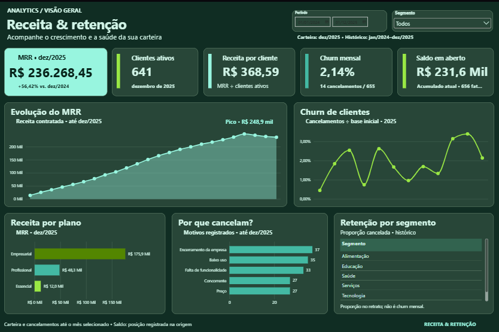

# Dashboard SaaS · Receita & retenção

**Como a receita recorrente evolui — e onde agir para reter clientes e sustentar o crescimento?**

Projeto de portfólio de análise de dados em Power BI, com uma empresa SaaS fictícia e histórico de **janeiro de 2024 a dezembro de 2025**.

[](https://app.powerbi.com/view?r=eyJrIjoiZTZjYmY1NWQtNzVlNi00NmVmLWI3ZTUtN2Y2OGY5MTc3OGVmIiwidCI6IjdiNzZjYWM5LTBkYTQtNGNmZC1hZWY1LWEyNDgyNDI5NmYyMiJ9)

### [↗ Abrir o portfólio com dashboard incorporado](https://gu1lho.github.io/dashboard-saas/)

### [↗ Explorar o dashboard interativo no Power BI](https://app.powerbi.com/view?r=eyJrIjoiZTZjYmY1NWQtNzVlNi00NmVmLWI3ZTUtN2Y2OGY5MTc3OGVmIiwidCI6IjdiNzZjYWM5LTBkYTQtNGNmZC1hZWY1LWEyNDgyNDI5NmYyMiJ9)

Use os filtros de período e segmento para explorar a carteira. A imagem acima é uma captura estática fornecida para o portfólio. O link abre o relatório interativo publicado pelo autor.

> O GitHub não executa iframes no README. A página [index.html](index.html) contém o relatório incorporado e pode ser aberta localmente ou hospedada como página estática.

## Objetivo da análise

Entender a evolução da receita recorrente e identificar fatores associados ao cancelamento de clientes, para orientar ações de retenção e crescimento.

## Contexto do negócio

O dataset simula uma empresa de **SaaS (Software como Serviço)** que vende acesso a um sistema por assinatura mensal. Ela atende empresas de diferentes segmentos e oferece três planos:

| Plano | Mensalidade de tabela | Limite de usuários |
|---|---:|---:|
| Essencial | R$ 99,00 | 5 |
| Profissional | R$ 249,00 | 20 |
| Empresarial | R$ 599,00 | 100 |

Os valores contratados consideram os descontos registrados em cada competência. Todos os dados são simulados e têm finalidade educacional.

## Perguntas de negócio

- A receita recorrente está crescendo de forma sustentável?
- Qual é a contribuição de cada plano para o MRR?
- Como o churn mensal evolui e quais motivos são registrados?
- Quais segmentos apresentam maior proporção histórica de cancelamentos?
- Que ações podem ser testadas para melhorar retenção e crescimento?

## Resultados · dezembro de 2025

| Indicador | Resultado | Como interpretar |
|---|---:|---|
| MRR | **R$ 236.268,45** | Receita mensal contratada, líquida dos descontos registrados |
| Variação sobre dez/2024 | **+56,42%** | Base de comparação: R$ 151.050,75 |
| Clientes ativos no encerramento do mês | **641** | Carteira após os cancelamentos de dezembro |
| Receita por cliente | **R$ 368,59** | MRR dividido pelos 641 clientes ativos |
| Churn mensal de clientes | **2,14%** | 14 cancelamentos / 655 clientes na base inicial |
| Saldo em aberto na origem | **R$ 231.564,85** | 656 faturas com valor faturado superior ao pago, em todo o histórico |

Os números foram recalculados a partir de `saas_padronizado.xlsx` e reconciliados com a captura fornecida. O saldo reflete a posição de pagamentos registrada no arquivo; não equivale automaticamente a valores vencidos em dezembro.

## Principais achados

### 1. Crescimento anual acompanhado de retração no último trimestre

O MRR saiu de **R$ 151.050,75 em dez/2024** para **R$ 236.268,45 em dez/2025**. Entretanto, o pico ocorreu em **set/2025, com R$ 248.937,20**: dezembro ficou **5,09% abaixo desse pico**. Vale decompor a variação entre novas assinaturas, expansão, contração e cancelamentos antes de atribuir a queda a um único fator.

### 2. O plano Empresarial concentra a receita

| Plano | MRR em dez/2025 | Participação |
|---|---:|---:|
| Empresarial | R$ 175.926,30 | 74,46% |
| Profissional | R$ 48.343,35 | 20,46% |
| Essencial | R$ 11.998,80 | 5,08% |

Essa concentração justifica acompanhar a saúde das contas empresariais e a exposição da receita a cancelamentos. A participação no MRR, isoladamente, não demonstra maior risco de churn.

### 3. Baixo uso e lacunas de funcionalidade merecem investigação

Foram registrados **159 cancelamentos** no histórico: encerramento da empresa (**37**), baixo uso (**35**), falta de funcionalidade (**33**), concorrente (**27**) e preço (**27**). Baixo uso e falta de funcionalidade somam **68 casos, ou 42,77%** dos cancelamentos.

São motivos declarados, não uma demonstração causal. A tabela de uso permite aprofundar o diagnóstico com indicadores anteriores ao cancelamento, evitando usar informações futuras.

### 4. Segmentos exigem comparação com denominadores e tempo de exposição

| Segmento | Cancelamentos / clientes no histórico | Proporção cancelada |
|---|---:|---:|
| Serviços | 28 / 124 | 22,58% |
| Varejo | 32 / 147 | 21,77% |
| Tecnologia | 26 / 123 | 21,14% |
| Saúde | 27 / 139 | 19,42% |
| Educação | 23 / 132 | 17,42% |
| Alimentação | 23 / 135 | 17,04% |

Serviços tem a maior proporção histórica nesta base. Essa medida **não é churn mensal** e não ajusta diferenças de antiguidade ou perfil entre clientes. Uma comparação mais robusta deve usar coortes com o mesmo tempo de acompanhamento.

## Recomendações para testar

| Frente | Ação proposta | Indicador de acompanhamento |
|---|---|---|
| Adoção | Testar onboarding orientado a valor e contato após queda de uso | Ativação, dias de uso e churn por coorte |
| Produto | Investigar funcionalidades citadas nas entrevistas de saída | Cancelamentos por funcionalidade e adoção das entregas |
| Contas empresariais | Acompanhar contas de maior MRR com sinais de risco | MRR em risco e retenção de receita |
| Crescimento | Decompor o MRR mensal e investigar a retração após setembro | Novo MRR, expansão, contração e MRR perdido |
| Cobrança | Separar faturas vencidas das ainda a vencer e testar lembretes | Saldo vencido e recuperação por faixa de atraso |

As ações são hipóteses para validação; este projeto não mede resultados de intervenções realizadas.

## Dados, método e reprodutibilidade

A base possui **800 clientes**, **800 assinaturas**, **3 planos** e **10.153 registros em cada uma das tabelas de histórico mensal, faturas e uso mensal**. O arquivo padronizado também inclui perfil, validações, categorias, mapeamento e pendências.

1. Conferência da estrutura, granularidade e chaves dos arquivos recebidos.
2. Consulta aos diagnósticos de padronização fornecidos: 51 registros de validação com quantidade de exceções igual a zero e nenhuma linha em pendências.
3. Recálculo independente dos indicadores em Python, sem alterar os arquivos originais.
4. Reconciliação dos resultados com a captura do painel.
5. Documentação das definições, limitações e oportunidades de aprofundamento.

A implementação interna do relatório Power BI não foi disponibilizada. Por isso, este repositório não apresenta medidas DAX ou um modelo PBIX como se fossem os arquivos originais. O [método documentado](docs/metodologia.md) explicita as regras usadas no recálculo.

```text
assets/dashboard-saas.png   Captura do relatório
data/dataset_saas.xlsx      Dataset original fornecido
data/saas_padronizado.xlsx  Base padronizada e seus diagnósticos
docs/metodologia.md         Definições e limites de interpretação
scripts/analisar.py         Recálculo dos indicadores
index.html                 Página com Power BI incorporado
requirements.txt           Dependência do script
```

Para reproduzir os indicadores, com Python instalado:

```bash
python -m pip install -r requirements.txt
python scripts/analisar.py
```

Para visualizar a página, abra `index.html` em um navegador com acesso à internet. O relatório incorporado depende da disponibilidade do link público do Power BI. O recálculo local não atualiza o relatório remoto.

## Competências demonstradas

Definição de KPIs SaaS, análise temporal, leitura de churn, análise de mix de receita, validação de dados, comunicação de resultados e apresentação de dashboards em Power BI.

**Autor:** [Guilherme F. Santos · GU1LHO](https://github.com/GU1LHO)
